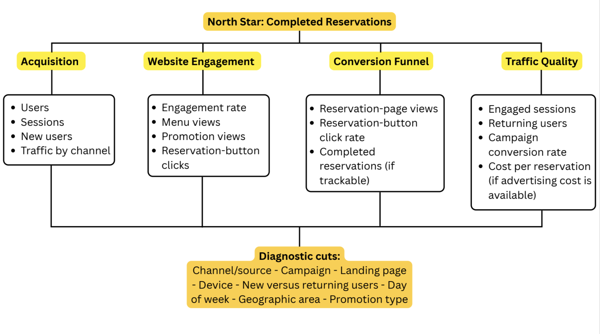

# Deliverable 1 — Analytics Blueprint (1–2 pages)

## 1. Client Context

- **Business Model:** Avenue Shabu is a local dine-in F&B business specializing in shabu-shabu. The website serves as the primary digital storefront to attract local diners, showcase the menu, and facilitate online bookings.

- **Primary Goal:** To maximize the volume of qualified offline dine-in visits, driven primarily through completed online reservations and high-intent walk-in signals (e.g., getting directions).

- **North Star Metric:** Completed Online Reservations.
  - This represents the clearest measurable outcome of the website’s ability to generate qualified dine-in visits. Direction clicks and other location-related actions will be tracked as secondary high-intent indicators because some customers may visit without making an online reservation.

## 2. Stakeholder Questions & Measurement Strategy

### Question 1: Which marketing channels are driving the most completed reservations, and where should we allocate our future marketing budget?

- **KPI:** Reservation Conversion Rate by Channel

- **Metric Definition:** The percentage of website sessions from a specific traffic source that result in a successfully submitted reservation.

  - **Formula:**  
    `(Completed Reservations from the Selected Channel ÷ Sessions from the Selected Channel) × 100`

- **How you will break it down (Dimensions):** Session Default Channel Grouping (e.g., Organic Search, Paid Social, Direct), Session Source/Medium, Campaign.

- **Data Source:** GA4 UI (Traffic Acquisition Report) and Looker Studio (for client-facing budget dashboards).

- **Assumptions/Notes:** A “completed reservation” is defined as a user reaching the `thank_you` confirmation page after successfully submitting the reservation. GA4 will record this conversion through one `generate_lead` event triggered on the confirmation page. The confirmation page and `generate_lead` event will not be counted as separate conversions to avoid duplicate counting. If a third-party reservation widget is used, it must pass the successful reservation status back to GA4.

### Question 2: At which stage of the reservation process are users dropping off the most, and is the mobile booking experience seamless?

- **KPI:** Reservation Funnel Drop-off Rate

- **Metric Definition:** The percentage of users who abandon the reservation process at a specific step without progressing to the next step.

  - **Formula:**  
    `(Users who completed Step N − Users who completed Step N+1) ÷ Users who completed Step N`

- **How you will break it down (Dimensions):** Device Category (Mobile, Desktop, Tablet), Browser, Landing Page.

- **Data Source:** GA4 UI (Funnel Exploration Report).

- **Assumptions/Notes:** The funnel is defined in three distinct steps:

  1. View reservation page
  2. Start reservation
  3. Reach the reservation confirmation page and trigger `generate_lead`

### Question 3: Are prospective customers engaging deeply with the menu before visiting, and which promotional banners drive the most menu views?

- **KPI:** High-Intent Menu Engagement Rate

- **Metric Definition:** The percentage of unique sessions that view the menu page and either scroll at least 75% of the page or trigger a custom 30-second timer event.

  - **Formula:**  
    `Unique high-intent menu sessions ÷ Total unique menu-page sessions × 100`

- **How you will break it down (Dimensions):** Page Path, Device Category, User Type (New vs. Returning), Banner ID, Banner Position, and Campaign.

- **Data Source:** GA4 UI and Looker Studio, using GTM scroll, timer, and promotional banner click events.

- **Assumptions/Notes:** Assumes a long-scroll menu format on the website. If the menu is a downloadable PDF, this KPI will be replaced by **Menu PDF Download Count** (tracking file extension clicks). Promotional banner performance will be evaluated by comparing banner clicks and the subsequent menu engagement rate by Banner ID, Banner Position, and Campaign.

# Deliverable 2 — KPI Tree / Metric Hierarchy Diagram (1 page)

This KPI tree represents the proposed measurement framework. Baselines and performance targets will be established after GA4 is implemented and sufficient data has been collected.

{fig-align="center" width="100%"}

## North Star KPI: Completed Reservations

Completed Reservations is the number of users who successfully completed a reservation when completion tracking becomes available. This represents the restaurant’s main website conversion and is more meaningful than page views or clicks.

**Note:** Completed reservations will be used as the North Star KPI if the reservation platform can be connected to GA4. If completion data is unavailable, reservation-button clicks will be used as a measurable proxy for reservation intent.

# Deliverable 3 — Event / Parameter Map (table, typically 1–2 pages)

| **KPI / Question Supported** | **Event Name** | **Trigger Definition** | **Required Parameters** | **Notes / Edge Cases** |
|---|---|---|---|---|
| Reservation conversion by channel | `view_reservation` | User opens the reservation page. | `page_location`, `page_path`, `page_title` | The event should fire once when the reservation page loads. |
| Reservation funnel drop-off | `reservation_start` | User begins entering information in the reservation form or opens the reservation widget. | `form_id`, `form_name`, `page_location`, `device_category` | If the reservation form is embedded, the trigger must be tested carefully. |
| Completed online reservations | `generate_lead` | User successfully completes a reservation and reaches the confirmation page. | `form_id`, `form_name`, `conversion_type`, `page_location` | This event should fire only after a successful reservation. Avoid counting both the confirmation page and the event as separate conversions. |
| Menu engagement | `view_menu` | User opens the menu page or menu section. | `menu_type`, `page_location`, `page_path`, `device_category` | If the menu is a PDF, track the PDF click or download instead. |
| High-intent menu engagement | `menu_engaged` | User scrolls at least 75% of the menu or remains on the menu for 30 seconds. | `engagement_type`, `menu_type`, `page_path`, `device_category` | Avoid firing the event more than once during the same session. |
| Promotional banner performance | `banner_click` | User clicks a promotional banner or special offer on the website. | `banner_id`, `banner_position`, `campaign_name`, `link_url`, `page_path` | Each banner should have a consistent ID so performance can be compared. |
| High-intent phone action | `click_to_call` | User clicks the restaurant’s phone number or call button. | `button_text`, `page_path`, `device_category`, `link_url` | This measures phone intent but does not confirm that a call was completed. |
| High-intent location action | `get_directions` | User clicks the Google Maps or directions button. | `button_text`, `page_path`, `device_category`, `link_url` | This measures directions intent but does not confirm an actual visit. |
| Online review traffic | `click_google_review` / `click_yelp_review` | User clicks a link to the restaurant’s Google or Yelp review page. | `platform`, `link_url`, `page_path`, `device_category` | This measures clicks to the review platforms, not whether the user submitted a review. |
| Campaign attribution | `campaign_interaction` | User completes a tracked interaction after arriving through a campaign URL. | `utm_source`, `utm_medium`, `utm_campaign`, `landing_page`, `interaction_type` | UTM values should remain connected to the user’s later interaction whenever possible. |

# Deliverable 4 — Validation Checklist Outline and Test Cases

## Validation Checklist

### 1. GTM and Data Collection

- Open the website in GTM Preview mode.
- Confirm the correct container and environment are loaded.
- Perform each tracked interaction and verify that the intended trigger fires.
- Check that each event fires only once per interaction to prevent duplicates.
- Confirm that event names, parameters, and variable values match the tracking plan.
- Verify that unrelated actions do not trigger the event.

### 2. GA4 DebugView and Realtime

- Open GA4 DebugView while testing with a debug-enabled browser.
- Confirm that the expected events appear shortly after each interaction.
- Check that all required parameters are populated and use the correct values and data types.
- Use the Realtime report to confirm that users, events, page paths, and traffic information are visible.
- Verify that events are not missing, duplicated, or assigned to the wrong page.

### 3. Reporting Sanity Checks

- Review standard GA4 reports after test data has been processed.
- Confirm that source, medium, and campaign values populate correctly.
- Verify that page title, page location, and page path dimensions match the pages visited.
- Check that event counts in reports are consistent with GTM Preview and DebugView.
- Confirm that internal traffic, test traffic, and duplicate events are excluded or identified appropriately.

### 4. BigQuery Export, If Enabled

- Confirm that test events appear in the appropriate `events_*` tables.
- Verify that event names are stored correctly.
- Check that parameters can be extracted from `event_params`.
- Confirm that timestamps, user identifiers, page information, source/medium, and campaign values are populated correctly.
- Compare BigQuery event counts with GA4 reports to identify missing or duplicate records.

## Test Cases

| **Test Case** | **Steps to Perform** | **Expected Events** | **Expected Parameters/Dimensions** |
|---|---|---|---|
| 1. Page load | Open a webpage in a new browser session. Navigate to a second page. | `page_view` for each page | `page_location`, `page_path`, `page_title`, and page referrer populate correctly. |
| 2. CTA click | Click the primary call-to-action button once. Repeat the action once more. | One `cta_click` event per click | `button_text`, `button_location`, `page_path`, and link URL are correct; no duplicate event fires. |
| 3. Form start | Open a form and enter information into the first field without submitting it. | `form_start` | `form_id`, `form_name`, and `page_path` populate correctly. |
| 4. Form submission | Complete all required fields and submit the form successfully. | `form_submit` or `generate_lead` | `form_id`, `form_name`, submission status, and page information are correct. The event should fire only after a successful submission. |
| 5. Outbound link | Click a link that directs users to an external website. | `click` or `outbound_click` | `link_url`, `link_domain`, `link_text`, and `page_location` identify the external destination correctly. |
| 6. Campaign and traffic attribution | Visit the site using a URL containing UTM parameters, such as `utm_source`, `utm_medium`, and `utm_campaign`. Complete one tracked interaction. | `page_view` and the related interaction event | Source, medium, campaign, page path, and event parameters retain the correct UTM values in GA4 and, if enabled, BigQuery. |

# Team Contribution Note

* **Jenny:** Deliverable 1 (Analytics Blueprint draft lead) + Overall document integration (Quarto/HTML) and GitHub publishing
* **Grace:** Deliverable 2 (KPI Tree visualization)
* **Sandy & Sora:** Deliverable 3 (Event / Parameter Map — event and trigger design, required parameters, and edge cases)
* **Frank:** Deliverable 4 (Validation Checklist & Test Cases)

# Appendix

*   [GitHub Repo](https://github.com/jennyjeong53/GA4-Assignments)
*   [GitHub Pages Website](https://jennyjeong53.github.io/GA4-Assignments/)